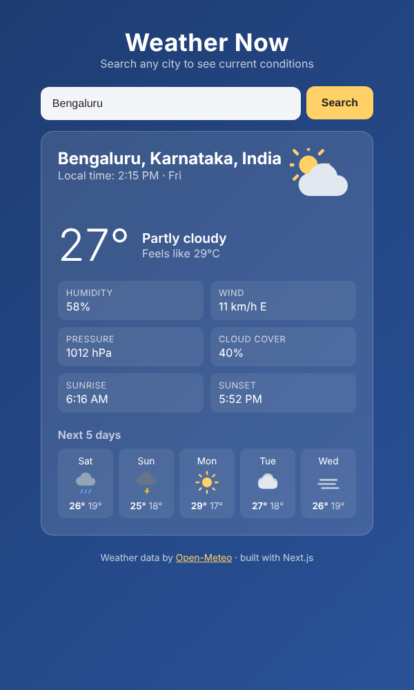

# Weather Now — Weather Information App (Next.js)

A Next.js app where a user searches for a city and sees the current weather, a matching weather icon, an hourly and 6-day forecast. It shows a loading state while data is fetched and clear error messages when the city is invalid or the data can't be fetched.



## Features

- 🔍 **City search with suggestions**: matching places appear as you type (with country flags), so "Paris, France" and "Paris, Texas" can be told apart. Use the arrow keys and Enter, or click
- 📍 **Use my location**: one tap shows the weather where you are (browser geolocation)
- 🕘 **Recent searches**: your last 5 places are saved as quick-access chips
- 🌡️ **°C / °F toggle**: switches temperatures (and wind to mph); your choice is remembered
- 🔗 **Shareable links**: the address bar updates (e.g. `/?id=2643743`), so reloading or sharing the link reopens the same place
- 🌤️ **Current weather**: temperature, "feels like", today's high/low, condition, humidity, wind, chance of rain, UV index, pressure, cloud cover, sunrise and sunset, plus the city's local time
- ⏱️ **Hourly forecast** for the next 24 hours, with rain chance
- 🎨 **Weather icons**: inline SVG icons for clear, partly cloudy, cloudy, fog, drizzle, rain, snow and thunderstorm, with day and night versions
- 📅 **6-day forecast** with icon, rain chance, high/low and a temperature-range bar for each day
- 🌓 **Light / Dark / Auto theme**: switch in the top right; Auto follows your device setting. The choice is remembered and applied before the page draws, so there's no flash of the wrong theme
- 🌙 **Night tint**: within either theme, the background shifts when it's night in the searched city
- ⏳ **Loading state**: a spinner appears and the button is disabled until the search finishes
- ⚠️ **Error handling** (see the table below), with a "Try again" button for server and network failures
- 🔑 **No API key needed**: uses the free [Open-Meteo](https://open-meteo.com/) API

## Tech stack

- **Next.js 15** (App Router) + **React 19**
- **Route Handler** (`app/api/weather/route.js`) acts as a backend that calls Open-Meteo
- Plain CSS (`app/globals.css`) with no UI libraries

## Getting started

Requires **Node.js 18.18 or newer**.

```bash
npm install
npm run dev
```

Open <http://localhost:3000>.

Production build:

```bash
npm run build
npm start
```

## Project structure

```
nextjs-weather-app/
├── app/
│   ├── api/
│   │   ├── weather/
│   │   │   └── route.js        # GET /api/weather?city= | ?id= | ?lat=&lon=
│   │   └── places/
│   │       └── route.js        # GET /api/places?q=...  (search suggestions)
│   ├── globals.css             # All styles
│   ├── icon.svg                # Favicon
│   ├── layout.js               # Root layout + page metadata
│   └── page.js                 # Home page -> <WeatherApp />
├── components/
│   ├── WeatherApp.jsx          # Main client component: state, fetching, errors, URL sync
│   ├── SearchForm.jsx          # Search input, suggestions dropdown, location button
│   ├── RecentSearches.jsx      # Recent-place chips
│   ├── UnitToggle.jsx          # °C / °F switch
│   ├── ThemeToggle.jsx         # Auto / Light / Dark switch
│   ├── HourlyForecast.jsx      # Next-24-hours strip
│   ├── Loading.jsx             # Spinner
│   ├── ErrorMessage.jsx        # Error box (+ optional "Try again")
│   ├── WeatherCard.jsx         # Current weather details
│   ├── Forecast.jsx            # 6-day forecast list
│   └── WeatherIcon.jsx         # SVG icons
├── lib/
│   ├── weather.js              # Geocoding + forecast calls, validation, error mapping
│   ├── weatherCodes.js         # WMO weather code -> description + icon
│   ├── format.js               # Time, unit conversion, wind and UV helpers
│   └── storage.js              # Safe localStorage helpers
├── public/screenshots/
├── jsconfig.json               # "@/..." import alias
├── next.config.mjs
└── package.json
```

## How it works

1. The user submits a city in `SearchForm`.
2. `WeatherApp` calls the app's own API: `GET /api/weather?city=<name>`.
3. The route handler (server-side):
   1. validates the city name,
   2. calls the **Open-Meteo Geocoding API** to turn the name into latitude and longitude,
   3. calls the **Open-Meteo Forecast API** for current conditions and a daily forecast,
   4. turns the raw response into a clean JSON shape and returns it.
4. The UI shows `Loading` → then `WeatherCard` or `ErrorMessage`.

Routing the calls through a Next.js API route keeps the third-party API out of the browser. If you later switch to a provider that needs an API key (for example OpenWeatherMap), put the key in `.env.local` and read it only in `lib/weather.js`.

### API response (success)

```json
{
  "location": { "name": "Bengaluru", "region": "Karnataka, India", "latitude": 12.97, "longitude": 77.59, "timezone": "Asia/Kolkata" },
  "current": {
    "time": "2026-11-20T14:15", "isDay": true, "temperature": 27.4, "feelsLike": 28.9,
    "humidity": 58, "cloudCover": 40, "pressure": 1012.3, "windSpeed": 11.2, "windDirection": 90,
    "description": "Partly cloudy", "icon": "partly",
    "units": { "temperature": "°C", "windSpeed": "km/h", "pressure": "hPa" }
  },
  "today": { "sunrise": "2026-11-20T06:16", "sunset": "2026-11-20T17:52" },
  "forecast": [{ "date": "2026-11-21", "max": 26, "min": 19, "description": "Slight rain", "icon": "rain" }]
}
```

### Error handling

| Situation | HTTP status | Message shown |
|---|---|---|
| Empty search | 400 | Please enter a city |
| Invalid characters (e.g. `1234$`) | 400 | Invalid city name |
| City doesn't exist | 404 | City not found |
| Shared link has an unknown place id | 404 | Location not found |
| Coordinates out of range | 400 | Invalid coordinates |
| Location permission denied | — | Couldn't get your location |
| Open-Meteo returns an error | 502 | Weather data unavailable (+ Try again) |
| Open-Meteo unreachable | 502 | Couldn't reach the weather service (+ Try again) |
| Open-Meteo takes longer than 10 s | 504 | Request timed out (+ Try again) |
| Response isn't valid JSON | 502 | Unexpected response (+ Try again) |
| Browser can't reach the app's server | — | Couldn't connect (+ Try again) |
| User goes offline | — | You're offline |

If you start a new search before the previous one finishes, the earlier request is cancelled (`AbortController`), so an old result can never replace a newer one.

## Credits

Weather data: [Open-Meteo](https://open-meteo.com/) (free for non-commercial use, no key required).
